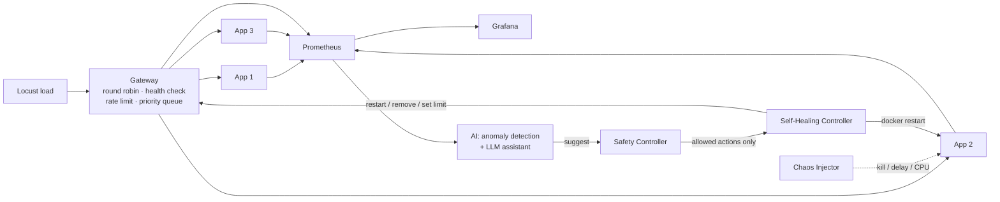

# Architecture

> Final diagram is made in Week 11–12 (Person 2). This is the working draft.

## Components

| Component | Folder | Owner | Job |
|---|---|---|---|
| Gateway | `gateway/` | P2 | Front door: picks a server, rejects extra traffic |
| App servers | `app/` | P1 | Do the actual work |
| Controller | `controller/` | P1 | Finds broken servers and fixes them |
| Chaos | `chaos/` | P1 | Breaks things on purpose to test recovery |
| Monitoring | `monitoring/` | P3 | Collects and shows numbers |
| Load test | `loadtest/` | P3 | Fake users |
| AI | `ai/` | P3 | Early warning + explanations |
